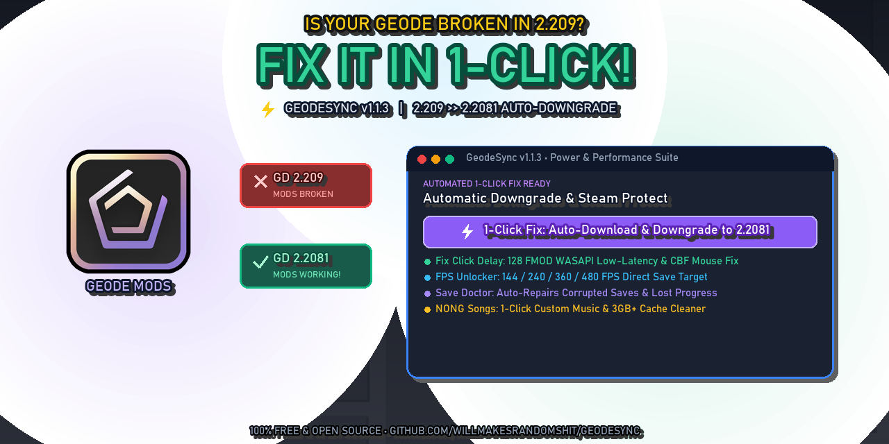

<p align="center">
  
</p>

<p align="center">
  <b>A Geometry Dash and Geode companion for Steam.</b><br>
  Switch supported game versions, protect saves, manage mods, and troubleshoot from one desktop app.
</p>

<p align="center">
  <a href="https://github.com/willmakesrandomshit/GeodeSync/releases/latest"></a>
  
</p>

## Download and get started

Download the latest published build from [GitHub Releases](https://github.com/willmakesrandomshit/GeodeSync/releases/latest). Choose the package for your system, then follow the [complete user guide](USER_GUIDE.md).

- **Windows:** Extract the entire ZIP to a normal folder and open `GeodeSync.exe` or `Run-GeodeSync.bat`. Keep the `_internal` folder beside the executable; do not move the executable by itself.
- **macOS Apple silicon:** Use `GeodeSync-macOS-arm64.zip`.
- **macOS Intel:** Use `GeodeSync-macOS-x86_64.zip`.

### App updates

Packaged builds check the official GitHub Releases API in the background. When a newer stable version is available, GeodeSync downloads the matching platform package, checks its size and SHA-256 digest against GitHub's release metadata, and validates archive paths before staging it beside the current app. It then applies the verified update and restarts automatically; while a Steam game-file download or switch is active, it waits for that operation to finish. Updates never run with administrator privileges. Install the app in a folder your account can write to (for example, `~/Applications` on macOS), or update it manually from the official Releases page if the operating system protects the install folder.

The digest check detects transfer corruption and mismatched release assets. GitHub release metadata and the package are served by the same GitHub account, so this is not an independent publisher signature. Windows Authenticode and Apple signing are used only when release signing credentials are configured; GeodeSync does not bypass operating-system warnings.
- **Linux / Steam Deck:** Use `GeodeSync-v<version>-Linux.tar.gz`. Extract the complete archive to a writable folder and run `./run.sh`. The Linux app supports Steam's Windows Geometry Dash files through Proton; Steam Deck users should use Desktop Mode. See [Linux setup notes](README-Linux.txt).

GeodeSync manages Geometry Dash installations provided by Steam; it does not replace Steam or Geode. Before switching versions, close the game and review the confirmation. The switch flow backs up detected saves, validates staged game files, and keeps recovery data if a swap is interrupted. If validation fails, the existing installation should be left in place.

## What it can do

- **⚡ AAA Gaming Dashboard:** Clean player profile hero card with glowing live stats (Stars, Demons, Moons, Diamonds, Coins, Orbs), setup status chips, and 1-click launch presets (Boosted, Vanilla, Tournament, Globed).
- **🛍️ Embedded Geode Mod Store:** Browse official Geode SDK mods directly inside the main app window with category filtering (All, QoL & Tools, Visual & Audio, Multiplayer, Installed), live instant search, and 1-click installation.
- **🏆 Live Pointercrate Top 150 Demonlist:** Real-time Demon rankings with point values, verifiers, video links, and **Live Save Progress Cross-Referencing** (showing 🏆 100% BEATEN or 🎯 X% (N att) next to each Demon).
- **🎵 Universal Audio Jukebox & Death SFX Hub:** 100% crash-proof Practice Music replacer (StayInsideMe.mp3) and custom explosion sound effects (explode_11.ogg) with 1-click vanilla rollback and zero memory DLL hooks.
- **💾 Comprehensive Save Hub & Compactor:** Multi-slot game saves, automated bloat purging (reducing 40MB+ bloated files down to ~1.8MB), and 1-click portable .geodesync bundle export & restore.
- **🩺 1-Click Health & Diagnostics Check (Ctrl+H):** Automated 8-point inspection of your Geometry Dash environment (version parity, Steam lock, Geode loader, save file decryption, OneDrive reparse locks, Visual C++ runtime, and mod conflicts) with instant 1-click auto-repair.
- **⌨️ Universal Keyboard Shortcuts:** Instant tab navigation with Ctrl+1 through Ctrl+6, Ctrl+F tab-aware search, F5 status refresh, and Ctrl+H diagnostics.
- **Switch Supported GD Versions:** Safely manage Geometry Dash versions (such as Geode-compatible 2.2081) and Steam's update lock.
- **Discord Rich Presence & Tray Mode:** Keep live Rich Presence active when minimized to the system tray, showing real-time stats and in-game state.

## Build and verify

The repository's GitHub Actions workflow builds Windows, macOS, and Linux packages for releases. macOS packages are built separately for Apple silicon and Intel. The Mac minimum-version values are build targets; they are not a claim that every OS version, processor, or Steam installation has been tested.

Run the regression suite with:

```sh
python -m unittest discover -s tests -v
```

See [macOS installation notes](README-macOS.txt), [Linux notes](README-Linux.txt), [release notes](release_notes.md), and [all releases](https://github.com/willmakesrandomshit/GeodeSync/releases).

Security and trust details: [Security policy](SECURITY.md), [Privacy notes](PRIVACY.md), and [Build instructions](BUILDING.md).
