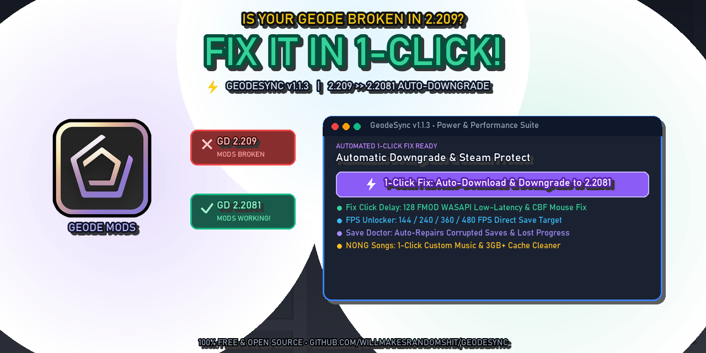

<p align="center">
  
</p>

# ⚡ GeodeSync

> Modern, zero-friction Geometry Dash version switcher, Geode protector, crash doctor, and input latency optimizer.


---

## 🚀 Overview

When RobTop pushes an update to **Geometry Dash** (such as 2.209), the **Geode** mod loader and community mods temporarily break until developers can release compatibility patches.

**GeodeSync** gives players an automated, 1-click desktop app to:
1. **Downgrade to Geode-compatible builds** (e.g. 2.2081) using Valve's official Steam depot mechanism.
2. **Real-time Live Progress Bar:** Track Steam depot download progress dynamically (`MB / ~195 MB` & percentage).
3. **⚡ 1-Click Fix Click Delay:** Lowers FMOD WASAPI audio buffer to 128 samples, tunes click queues, and optimizes Click Between Frames (CBF) mouse polling for zero-delay input.
4. **🩺 1-Click Crash Doctor:** Scans Geode crash logs, pinpoints faulty mod IDs and exception codes, and allows 1-click disabling of broken mods.
5. **🚀 Official Geode Auto-Installer:** Detects if Geode is missing, pulls the latest installer from GitHub, and sets it up seamlessly.
6. **🔄 Version Archive Selector:** Effortlessly switch between GD 2.2081, 2.2074, 2.113, or custom manifests.
7. **Prevent unwanted auto-updates:** Locks Steam's game manifest to Read-Only so Steam never overwrites your game.
8. **1-Click Save Data Backup & Restore:** Protects your stars, demons, coins, and levels with automated backups.

---

## 📥 Download

Grab the latest version from the **[Releases](https://github.com/willmakesrandomshit/GeodeSync/releases)** tab:
* **`GeodeSync-v1.1.2-Windows.zip` (Recommended):** Extract and double-click `Run-GeodeSync.bat` to launch instantly with zero popups!
* **`GeodeSync.exe`:** Standalone portable executable.

> [!NOTE]
> ### 🛡️ "Windows protected your PC" Note:
> Windows SmartScreen shows a blue warning window on **ALL** new open-source indie software downloaded from GitHub because indie developers do not pay Microsoft \$400/yr for corporate EV certificates.
> * **To run:** Click **"More info"** ➔ **"Run anyway"** (the exact same thing you do when installing Geode or Mega Hack!).
> * Or simply extract the **ZIP** version and double-click **`Run-GeodeSync.bat`**, which automatically launches without popups.

---

## 🛠️ How It Works

* **Depot Downloader:** Interacts with Steam Console (`download_depot 322170 322171 <manifest_id>`).
* **Manifest Protection:** Toggles `IsReadOnly` on `steamapps/appmanifest_322170.acf` so Steam can't overwrite downgraded game files.
* **Auto-Updater:** Queries `version.json` and GitHub Releases on launch in a non-blocking background thread.
* **Safety Backup:** Automatically archives previous executables and libraries in `backup_latest` before patching.

---

## 💻 Building from Source

```bash
git clone https://github.com/willmakesrandomshit/GeodeSync.git
cd GeodeSync
pip install pyinstaller pillow
python -m PyInstaller --noconfirm --clean --onefile --windowed --name="GeodeSync" --icon="icon.ico" --version-file="version_info.txt" --manifest="app.manifest" --add-data="icon.ico;." main.py
```
Executable will be generated in `dist/GeodeSync.exe`.
